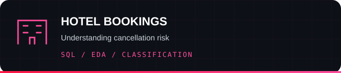
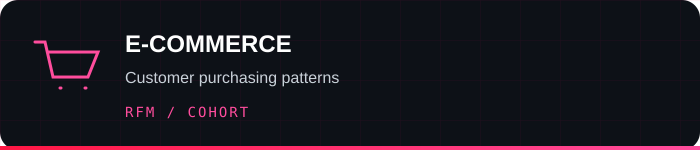

  
   
  
   
  

## 🌸 自己紹介

東京電機大学 システムデザイン工学部 情報システム工学科の大学3年生（2028年卒業予定）です。

Python・SQLを中心にデータ分析を学び、公開データを使った分析プロジェクトに取り組んでいます。データから課題を発見し、根拠のある改善施策としてビジネスにつなげることに関心があります。将来は、データアナリスト／データサイエンティストとして意思決定を支える仕事を目指しています。

- 顧客・ユーザー行動データの探索的データ分析と可視化
- SQLによるデータ抽出・集計、Pythonによる前処理・分析
- 分析結果から課題を整理し、改善施策まで考えるプロセスを実践
- Machine Learningによる予測と、SHAPを用いたモデル解釈を学習

## 🔥 制作物

### 1. ホテル予約キャンセル分析

**完成・公開済み**

- **目的:** キャンセル率が高い予約の傾向を把握し、予約登録時点の情報でキャンセルを予測できるか検証したうえで、業務での活用施策を考える。
- **使用技術:** Python / SQL / pandas / scikit-learn / SHAP / Streamlit / Plotly / PostgreSQL / Docker Compose
- **取り組み内容:** EDA、時系列を考慮したデータ分割、Random Forestによる分類、SHAPによる予測根拠の確認、施策提案までを実施。分析結果と1件ごとの予測を確認できるStreamlitダッシュボードを公開。

[リポジトリを見る →](https://github.com/gaku213waka/hotel-booking-cancellation-analysis)　｜　[Streamlitアプリを開く →](https://hotel-booking-cancellation-analysis-j8uhs3nftdhl9yj2dldwus.streamlit.app/)

### 2. ECサイト購買分析

- **目的:** ECサイトの顧客属性・購買行動・継続率を分析し、利益向上につながる課題と施策を検討する。
- **使用技術:** BigQuery / SQL / Python / pandas / Matplotlib / Seaborn / Jupyter Notebook
- **取り組み内容:** BigQuery Public Dataset「thelook_ecommerce」を用いて、EDA、RFM分析、コホート分析を実施。優良顧客の育成と初回購入後の定着を課題として整理し、レコメンドやフォロー施策を提案。

[リポジトリを見る →](https://github.com/gaku213waka/ecommerce-sales-analysis)

### 3. Webサイトのユーザー行動分析

- **目的:** ECサイト内のユーザー行動を分析し、CV率の改善につながる課題と施策を検討する。
- **使用技術:** BigQuery / SQL / Python / pandas / NumPy / Matplotlib / Seaborn / Jupyter Notebook
- **取り組み内容:** Google Analytics Sampleデータを用いて、流入元、デバイス、ブラウザ、ランディングページ、離脱ページを段階的に分析。離脱傾向を整理し、ページ導線や商品カテゴリに関する改善施策を提案。

[リポジトリを見る →](https://github.com/gaku213waka/User_Behavior_Analysis)

## ⚡ 技術スタック

| 分野 | 技術 |
|---|---|
| データ分析 | `Python` `SQL` `pandas` `NumPy` |
| 可視化 | `Matplotlib` `Seaborn` `Plotly` |
| Machine Learning | `scikit-learn` `SHAP` |
| データ基盤・DB | `BigQuery` `PostgreSQL` |
| アプリ・開発環境 | `Streamlit` `Docker Compose` `Git` `GitHub` `Jupyter Notebook` |

## 📊 GitHubでの活動

  

その他のコントリビューション表示

 

 

 
<b>ご覧いただき、ありがとうございます。</b>
  

